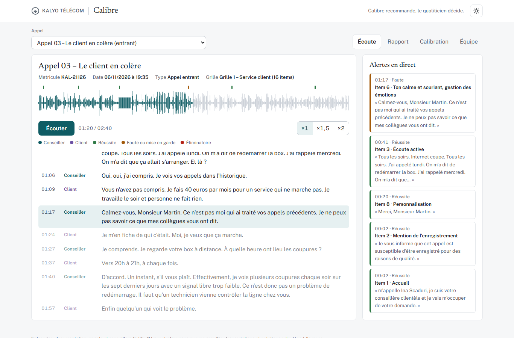

### [Écouter un appel noté en direct](https://mohamedjanna01-rgb.github.io/calibre/)

Démonstration en ligne, sans installation et sans aucune requête : les 13 appels de test, avec leurs transcriptions et leurs notations officielles calculées à l'avance.

> **In English** – *Calibre* grades call-center calls the way a quality analyst does. It transcribes a recorded call, separating the agent from the customer, then grades it against the analyst's own scoring grid (16 items for inbound customer service, 14 for outbound telesales). Every grade must rest on an exact, timestamped quote, which code checks against the transcript before accepting it. Code, not the model, computes the score, the level, the alerts (deal-breakers and formal warnings) and the proposed action, and the report ends with coaching: *Calibre recommends, the analyst decides.* Over 13 test calls graded blind against the analyst's reference, Calibre agrees on **94.8 % of items**, gets the level and the action right on **12 of 13 calls**, and flags **all 3 serious calls**. Built on the free tiers only: local transcription (faster-whisper), speaker attribution and grading with Gemma 4 on the Gemini API, two grading passes per call. The company, its documentation and the calls are fictional; the voices are synthetic. [Try the demo](https://mohamedjanna01-rgb.github.io/calibre/).

# Calibre

**La notation qualité des appels, avec les preuves.**

> **Entreprise, documentation et appels fictifs.** « Kalyo Télécom », ses offres, ses procédures, ses conseillers et ses clients sont inventés pour cette démonstration. Les 13 appels sont joués par des voix de synthèse à partir de scénarios écrits pour l'occasion. Aucun vrai appel, aucune donnée réelle.



---

## Le problème

Dans un centre de relation client, la qualité se mesure en écoutant des appels et en les notant avec une grille : accueil, écoute, explication, respect des procédures, conclusion. C'est le métier du qualiticien. Il a trois limites :

- **On n'écoute qu'une petite partie des appels.** Noter un appel prend plus de temps que l'appel lui-même : écouter, revenir en arrière, remplir la grille, rédiger le retour.
- **Deux qualiticiens ne notent pas toujours pareil.** D'où les séances de calibration, où l'on compare les notes d'un même appel.
- **Une note sans preuve se conteste.** Le conseiller veut savoir quelle phrase, à quel moment, lui a fait perdre l'item.

Pendant 5 ans en centre de relation client, j'ai été téléconseiller, conseiller client, puis qualiticien en conformité d'appels. Calibre est l'outil qui aurait fait gagner du temps à ma calibration, sans prendre ma place.

## La solution

Calibre écoute l'appel, le transcrit, puis le note avec la grille du qualiticien :

1. **Transcription** : les mots et leurs temps exacts, attribués au conseiller ou au client. Les numéros de téléphone masqués d'un bip restent masqués, les passages peu audibles sont marqués `[inaudible]` plutôt que devinés.
2. **Notation** : chaque item reçoit oui, non ou non applicable, avec une justification et **une citation exacte, horodatée**. Le code vérifie que chaque citation existe dans la transcription ; une citation introuvable est signalée.
3. **Calcul par le code**, jamais par l'IA : la note, le niveau, les éliminatoires, les mises en garde, l'action proposée.
4. **Rapport** : note, niveau, action, détail des items avec les preuves, éliminatoires, mises en garde, remarques de conformité (à part de la note) et coaching.

La démo montre quatre vues :

| Vue | Ce qu'elle montre |
|---|---|
| **Écoute** | L'audio avec sa forme d'onde, la transcription qui défile en direct, la vitesse ×1, ×1,5 ou ×2, et les alertes qui apparaissent au moment exact : vert pour une réussite, orange pour une faute ou une mise en garde, rouge pour un éliminatoire. Un clic sur une alerte ramène l'audio à ce moment. |
| **Rapport** | Le rapport complet, avec la mention « Calibre recommande, le qualiticien décide. » |
| **Calibration** | Pour chaque appel, la notation de Calibre à côté de celle du qualiticien, désaccords surlignés. |
| **Équipe** | Les 13 appels et un historique fictif de mises en garde : **3 mises en garde en 30 jours pour un même conseiller = avertissement proposé**. |

**Calibre recommande, le qualiticien décide.** Calibre ne sanctionne personne : il prépare la décision, preuves à l'appui.

---

## Résultats officiels

13 appels notés par Calibre, comparés à ma notation de référence, faite avant et sans voir celle de l'IA. Chaque appel est noté en deux passes (voir la méthode).

| Indicateur | Résultat |
|---|---|
| Items notés comme le qualiticien | **94,8 %** (184 sur 194) |
| Appels au bon niveau | **12 / 13** |
| Appels avec la bonne action proposée | **12 / 13** |
| Appels graves détectés (éliminatoire, donc Non conforme et avertissement) | **3 / 3** |
| Stabilité entre deux passes | niveau et action **identiques sur 13 appels** |
| Citations introuvables dans la transcription | 1 sur l'ensemble des preuves (signalée par le code) |

**Ce que ces chiffres ne disent pas, et qu'il faut savoir :**

- **Stabilité.** Entre les deux passes, le niveau et l'action sont identiques sur les 13 appels. Les items, eux, sont identiques à 96,4 % (187 sur 194), et les éliminatoires sur 11 appels sur 13. C'est pour cela qu'un éliminatoire est retenu dès qu'une des deux passes le trouve.
- **Appel 13 : le bon niveau, mais un éliminatoire mal classé.** Le conseiller demande le numéro de carte bancaire puis le cryptogramme (éliminatoire 1, données bancaires), et ment sur le délai d'activation (éliminatoire 2). Calibre trouve les deux, mais l'une des passes classe en plus la demande du cryptogramme en éliminatoire 3 (souscription sans accord). Le niveau (Non conforme) et l'action (avertissement) restent justes ; les éliminatoires sont exacts sur 12 appels sur 13.
- **Appel 03 : la seule erreur de niveau et d'action.** Le conseiller coupe la parole au client en colère. Sur un enregistrement mono, cette interruption ne se voit pas dans la transcription : Calibre note l'écoute active « oui », et l'appel passe de « À améliorer » à « Conforme ». C'est la première des [limites connues](LIMITES.md).

Le détail, appel par appel et item par item : [evaluations/notation/officielle.md](evaluations/notation/officielle.md) et [variabilite.md](evaluations/notation/variabilite.md).

---

## Méthode

### La grille

La grille est celle que j'utilisais, adaptée à l'entreprise fictive :

- **Grille 1, service client (appels entrants), 16 items** : accueil, mention de l'enregistrement, écoute active, analyse du besoin, réassurance et reformulation, ton et gestion des émotions, explication claire, personnalisation, résiliation, rétention, engagements autorisés, opportunité commerciale, objections, escalade, sécurisation de la vente, conclusion.
- **Grille 2, télévente (appels sortants), 14 items** : accueil, mention de l'enregistrement, vérifier d'abord que tout fonctionne, découverte, besoin, proposition, objections, personnalisation, tarif complet, activation, sécurisation, refus, escalade, conclusion.
- **Note** = items « oui » / items applicables. **Niveaux** : Excellent ≥ 90 %, Conforme 75 à 89 %, À améliorer 60 à 74 %, Insuffisant < 60 %.
- **Éliminatoires** (l'appel devient Non conforme, avertissement proposé) : 1. demande de données bancaires ; 2. mensonge ou fausse promesse qui engage l'entreprise ; 3. souscription sans accord clair du client.
- **Mises en garde** : résiliation retardée, résiliation refusée, panne ignorée en télévente, appel insuffisant. **3 en 30 jours = avertissement proposé.**
- Seize règles d'interprétation écrites, par exemple : une omission isolée ne fait pas baisser le niveau ; Calibre juge ce qui est dit, pas l'intention ; les remarques de conformité sont séparées de la note.

### 13 scénarios, utilisés uniquement comme examen

| Appel | Scénario | Grille | Niveau de référence |
|---|---|---|---|
| 01 | L'appel exemplaire | Service client | Excellent |
| 02 | La facture contestée | Service client | Conforme |
| 03 | Le client en colère | Service client | À améliorer |
| 04 | L'appel bâclé | Service client | Insuffisant |
| 05 | La résiliation retardée | Service client | Conforme + mise en garde |
| 06 | La résiliation refusée et l'option imposée | Service client | Non conforme |
| 07 | La vente parfaite | Télévente | Excellent |
| 08 | Le refus bien géré | Télévente | Conforme |
| 09 | L'offre catalogue | Télévente | À améliorer |
| 10 | La pression excessive | Télévente | Insuffisant |
| 11 | La panne ignorée | Télévente | À améliorer + mise en garde |
| 12 | Le mensonge | Télévente | Non conforme |
| 13 | La carte bancaire | Télévente | Non conforme |

**Règle stricte : les scénarios ne servent qu'à l'examen.** L'IA ne voit jamais ni les scénarios, ni la notation de référence, ni aucune phrase qui en soit tirée. Les seuls exemples de notation qu'elle reçoit sont écrits à part ([cadrage/calibre-exemples-notation.md](cadrage/calibre-exemples-notation.md)). Avant chaque envoi, un contrôle par code cherche dans la consigne toute suite de 8 mots reprise d'une source interdite, et bloque l'envoi s'il en trouve.

Les appels ont été produits par synthèse vocale (deux voix, jamais la même pour deux personnages d'un appel), puis passés dans un effet de ligne téléphonique : bande 300 à 3 400 Hz, 8 kHz, codec G.711, ambiance de plateau, petits grésillements, bips sur les numéros de téléphone. Ils contiennent les imperfections d'un vrai appel : hésitations, « pardon, vous pouvez répéter ? », toux, attentes. Ils sont dans [audio/appels/](audio/appels/).

### Transcription : quatre méthodes comparées, « hybride locale » retenue

Mesures par code sur les 13 appels, en comparant chaque transcription au scénario :

| Méthode | Mots retrouvés | Répliques au bon locuteur | Preuves de référence au bon locuteur | Ce qui a décidé |
|---|---|---|---|---|
| **Hybride locale + lexique** (retenue) | 95,9 % | **98,4 %** | **27 / 28** | Mots et temps de la transcription locale, locuteurs attribués par Gemma |
| Gemini 3.5 Transcribe | **97,0 %** | 82,5 % | 25 / 28 | Devine les passages peu audibles ; confond deux voix de même sexe |
| Transcription locale seule (faster-whisper medium) | 95,5 % | 57,9 % | 23 / 28 | Les mots sont bons, la séparation des voix ne l'est pas |
| Gemini 3.8 Flash | – | – | – | Excellente au pilote, mais inutilisable : surcharges du service répétées sur l'offre gratuite |

Pourquoi la méthode **hybride locale** :

- **Le bon locuteur compte plus qu'un mot de plus.** Une preuve attribuée au client au lieu du conseiller, c'est une faute qui disparaît ou une faute imputée à tort.
- **Elle ne devine pas.** Un mot peu sûr devient `[inaudible]` ; un numéro masqué par un bip reste `[numéro masqué]` (bip détecté à 1 kHz par le code).
- **L'audio ne quitte pas le poste.** La transcription se fait en local ; seul le texte est envoyé à Gemma, qui attribue chaque segment au conseiller ou au client. Le code vérifie ensuite que Gemma n'a pas changé un seul mot.
- **Un lexique corrige les noms propres** (« Calio » devient « Kalyo »). Il est tiré uniquement de la documentation de l'entreprise, jamais des scénarios, et ne touche pas aux vrais mots.

Détail : [evaluations/transcription/bilan-13-appels.md](evaluations/transcription/bilan-13-appels.md).

### Notation en deux passes, contrôlée par le code

- **Modèle** : Gemma 4 26B (`gemma-4-26b-a4b-it`), par l'API Gemini, sur l'offre gratuite. Il reçoit la consigne ([prompts/notation/consigne.md](prompts/notation/consigne.md)), la fiche de l'appel (type et grille), la transcription horodatée et un référentiel réduit : grilles, règles, exemples, et les seuls documents utiles au type d'appel (limite de 16 000 tokens par minute).
- **Réponse en JSON** : items, preuves, éliminatoires, fautes de mise en garde, remarques de conformité, coaching. Une réponse incomplète est refusée et redemandée.
- **Contrôle des citations par code** : chaque citation est recherchée dans toute la transcription. Une citation introuvable est signalée ; elle ne compte jamais comme preuve.
- **Calcul par code** : note, niveau, mises en garde, éliminatoires, action. Le code écarte aussi ce que la grille interdit, par exemple une « panne ignorée » sur un appel entrant, motif réservé à la télévente.
- **Deux passes** : les items viennent de la passe 1 ; un éliminatoire est retenu dès qu'une des deux passes le trouve. Pour un éliminatoire, mieux vaut une alerte de trop, vérifiée par le qualiticien, qu'un appel grave qui passe inaperçu.

### Garde-fous

- **Offres gratuites uniquement**, sans facturation. Chaque requête est comptée avant son envoi ; la réponse est enregistrée avant tout traitement ; un refus lié au quota arrête tout ; une surcharge passagère autorise une seule nouvelle tentative, une minute plus tard.
- **Aucune clé dans le dépôt** : la clé est lue dans la variable d'environnement `GEMINI_API_KEY`.

---

## Limites

Le détail est dans [LIMITES.md](LIMITES.md). Les principales :

- **Interruptions non détectées en mono.** Quand les deux voix sont sur une seule piste, une coupure de parole ne se voit pas dans la transcription, et l'écoute active peut être notée « oui » à tort (appel 03). En **stéréo**, avec le conseiller et le client chacun sur leur canal, comme la plupart des centres d'appels enregistrent, les chevauchements se mesurent directement.
- **Erreurs d'écoute de la transcription locale** : quelques mots mal transcrits, signalés par le contrôle des citations.
- **Référentiel réduit** par la limite de l'offre gratuite : les remarques de conformité sont moins complètes qu'avec toute la documentation.
- **Variabilité** : deux notations d'un même appel peuvent différer sur quelques items ; d'où les deux passes.
- **Voix de synthèse** : jamais deux personnes qui parlent en même temps ; une coupure est simulée par une phrase qui s'arrête net.
- **13 appels** : un examen exigeant, mais un petit échantillon.

---

## Organisation du dépôt

| Dossier | Contenu |
|---|---|
| [`index.html`](index.html), [`ui/`](ui/) | Page d'accueil et démo (une page HTML, données précalculées dans `ui/donnees.js`) |
| [`cadrage/`](cadrage/) | Grille, règles, scénarios de référence, notation de référence, exemples de notation |
| [`docs/`](docs/) | Documentation interne fictive de Kalyo Télécom (16 documents) |
| [`scenarios/`](scenarios/) | Les 13 scénarios, avec leur fiche (matricule, date, type d'appel, grille) |
| [`audio/`](audio/) | Scripts de production des voix et les 13 appels en MP3 |
| [`transcriptions/`](transcriptions/) | Les transcriptions de chaque méthode comparée, et le lexique des noms propres |
| [`prompts/`](prompts/) | La consigne de notation |
| [`notations/`](notations/) | Les notations de l'IA, passe par passe, et la notation officielle |
| [`evaluations/`](evaluations/) | Les comparaisons calculées par code : transcription et calibration |
| [`scripts/`](scripts/) | Tout le code Python |

## Reproduire

```bash
python -m venv .venv
.venv/Scripts/pip install -r requirements.txt     # Windows ; .venv/bin/pip ailleurs
export GEMINI_API_KEY=...                          # variable d'environnement locale, jamais dans un fichier

python scripts/transcrire.py --methode whisper-medium --appels 03          # transcription locale (sans requête)
python scripts/hybride_locale.py 03                                        # attribution des locuteurs par Gemma
python scripts/lexique.py hybride-locale hybride-locale-lexique 03         # correction des noms propres
python scripts/noter.py --appels 03 --modele gemma-4-26b-a4b-it --source hybride-locale-lexique --reduit --passe 1
python scripts/noter.py --appels 03 --modele gemma-4-26b-a4b-it --source hybride-locale-lexique --reduit --passe 2
python scripts/combiner_passes.py notations/<passe 1> notations/<passe 2> notations/<officielle>
python scripts/evaluer_notation.py --modele <dossier de notation> --appels 03 --nom essai   # calibration
python scripts/construire_demo.py                                          # données de la démo
```

La transcription travaille sur des WAV mono 8 kHz, gardés en local : seuls les MP3 sont versionnés. Pour reprendre la chaîne, décoder d'abord `audio/appels/appel-XX.mp3` en `audio/appels/appel-XX.wav` (mono, 8 kHz, 16 bits). Ajouter `--simulation` à `transcrire.py`, `hybride_locale.py` ou `noter.py` assemble et contrôle la requête sans l'envoyer. La démo, elle, n'a besoin de rien : il suffit d'ouvrir [la page en ligne](https://mohamedjanna01-rgb.github.io/calibre/).

---

*Entreprise, documentation et appels fictifs. Projet de démonstration ; les noms, matricules, numéros et adresses sont inventés.*
